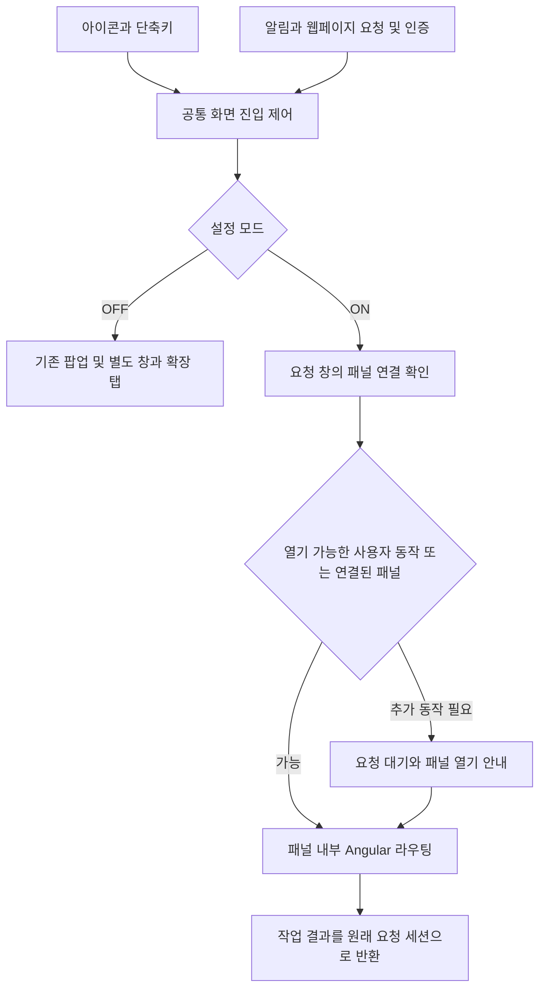

# Chrome 확장 프로그램의 사이드 패널 모드 설계

설정에 **사이드 패널 모드**를 추가한다. 기본값은 OFF이며 기존 팝업·별도 창 진입 방식을 사용한다. 사용자가 ON으로 바꾸면 확장 아이콘, 단축키, 웹페이지 알림, 잠금 해제, 항목 추가·편집, 인증 등 **확장 자체 화면을 여는 모든 진입점이 요청이 발생한 Chrome 창의 사이드 패널을 사용**한다. OFF로 되돌리면 이후 진입점은 기존 방식으로 돌아간다.

**구현 상태:** [SidePanelMode](../apps/browser/src/platform/side-panel/side-panel-mode.ts)에 모드 저장·창별 요청 중계·취소 처리를 추가하고, 화면 스타일 설정과 기존 화면 진입 계층을 연결했다. 아래 현재 구조 표는 변경 전 AS-IS를 뜻한다. 테스트 실행 및 수동 검증 목록은 [구현·테스트 가이드](browser-extension-custom-features-testing.md)를 따른다.

외부 SSO 웹사이트, Chrome 권한 UI, 운영체제의 파일 선택·생체인증 창은 각 플랫폼이 표시한다. 확장 자체 화면의 진입점을 패널로 통합한다. 패널 사용 중의 파일 업데이트·재로드는 [GitHub Releases 자동 업데이트 설계](browser-extension-github-auto-update.md)와 함께 적용한다. 실제 네이티브 패널 E2E는 사용자 실행 대상으로 남겨 두었다.

## 설정과 모드 전환

### 사용자 설정

[설정의 화면 스타일 화면](../apps/browser/src/vault/popup/settings/appearance.component.html)에 다음 항목을 추가한다.

| 항목      | 설계                                                           |
| --------- | -------------------------------------------------------------- |
| 표시 이름 | 사이드 패널 모드                                               |
| 설명      | Bitwarden 화면을 팝업 대신 사이드 패널에서 엽니다.             |
| 기본값    | OFF                                                            |
| 적용 범위 | 현재 Chrome 프로필의 확장 전체와 모든 일반 창                  |
| 저장      | 로그인 전에도 읽을 수 있는 기기 단위 전역 영속 상태            |
| 계정 변경 | 계정을 전환하거나 잠가도 모드 설정을 유지                      |
| 지원 환경 | 검증된 Chrome 환경과 필수 Side Panel API를 지원할 때 설정 가능 |
| ON일 때   | 새 확장 화면 요청을 사이드 패널로 전달                         |
| OFF일 때  | 기존 팝업·별도 창·확장 탭 경로 사용                            |

`SidePanelMode`에서 `enabled$`, 설정 변경, 요청 중계를 제공한다. `chrome.storage.local`의 `customSidePanelModeEnabled`에 저장하며 값이 없으면 `false`다. 저장소 변경 이벤트로 UI와 백그라운드를 동기화한다. 창별 안전한 탐색 경로는 `chrome.storage.session`에만 저장하고 편집 폼·인증 비밀값은 저장하지 않는다.

이 설정은 런타임 사용자 설정이다. ON과 OFF를 바꾸는 데 재빌드·재설치·별도 CI 산출물이 필요하지 않으며, 한 배포 ZIP에 두 동작을 모두 포함한다. 패널 모드의 설정 변경을 계정별 원격 기능 플래그로 대체하지 않는다.

### 전환 규칙

| 상황                              | 처리                                                           |
| --------------------------------- | -------------------------------------------------------------- |
| OFF에서 ON                        | 설정과 Chrome 아이콘 동작을 반영한 뒤 다음 진입부터 패널 사용  |
| ON에서 OFF                        | 아이콘의 팝업 동작을 복구하고 다음 진입부터 기존 방식 사용     |
| 설정 화면을 열어둔 상태           | 현재 화면을 강제로 닫거나 재로드하지 않음                      |
| 인증 요청 진행 중                 | 완료 또는 취소 전 모드 전환을 거부하고 오류 표시               |
| 다른 Chrome 창이 열려 있음        | 모드 상태를 모든 등록된 UI에 전달하고 새 요청에 같은 설정 적용 |
| Chrome 또는 service worker 재시작 | 영속 설정을 읽고 아이콘·패널 동작을 다시 일치시킴              |
| 플랫폼 설정 반영 실패             | 성공으로 표시하지 않고 이전 모드로 복구하거나 재시도 상태 표시 |

설정 저장 뒤 패널을 자동으로 열기 위해 비동기 작업을 연속 실행하지 않는다. 사용자가 바로 열기를 원하면 별도 **사이드 패널 열기** 버튼을 제공한다. 설정 변경과 실제 패널 표시를 분리해 사용자 동작이 필요한 API 호출 조건을 지킨다.

모드 변경은 백그라운드의 단일 적용 경로에서 직렬화한다. 설정 로딩·전환 중인 요청을 임의로 OFF로 처리하지 않는다. 대기 때문에 사용자 동작 조건을 잃은 요청은 패널 열기 안내로 전환한다. ON 상태에서 열기에 실패했다고 기존 팝업을 몰래 생성하지 않는다.

## 현재 구조와 변경 필요 사항

| 영역                                                                                                  | 현재 동작                                                                                         | 변경 후 동작                                                          |
| ----------------------------------------------------------------------------------------------------- | ------------------------------------------------------------------------------------------------- | --------------------------------------------------------------------- |
| [Manifest](../apps/browser/src/manifest.v3.json)                                                      | `sidePanel` 권한은 있으나 아이콘 기본 동작은 `popup/index.html`이고 기본 패널 경로는 빈 페이지다. | 기본 OFF 동작을 유지하면서 ON에서 아이콘과 패널 경로를 런타임 전환    |
| [BrowserApi](../apps/browser/src/platform/browser/browser-api.ts)                                     | `openSidePanel`은 `tabId`만 받는다.                                                               | 창 단위 패널 열기와 기능 지원 확인 추가                               |
| [BrowserPopupUtils](../apps/browser/src/platform/browser/browser-popup-utils.ts)                      | `sidebar`, `sidepanel`, `popout`, `popup`을 별도 판별한다.                                        | 필요한 기능별 문맥 판별을 제공하고 모든 호출자가 모드를 일관되게 사용 |
| [BrowserActionsService](../apps/browser/src/platform/actions/browser-actions.service.ts)              | `openPopup()`으로 브라우저 팝업을 연다.                                                           | 같은 화면 요청을 모드에 따라 전달하는 계층에 연결                     |
| [main.background.ts](../apps/browser/src/background/main.background.ts)                               | `setPopup()`과 `openPopup()`으로 위험 비밀번호 등 특정 화면을 연다.                               | ON에서는 패널 내부 라우팅 요청으로 전환                               |
| [notification.background.ts](../apps/browser/src/autofill/background/notification.background.ts)      | 알림에서 팝업 경로를 변경하고 잠금 해제용 별도 창을 연다.                                         | 요청 창·탭을 유지한 채 패널로 전달                                    |
| [인증용 창](../apps/browser/src/auth/popup/utils/auth-popout-window.ts)                               | 로그인·잠금 해제·SSO 결과·2FA에 별도 창을 사용한다.                                               | ON에서는 패널의 인증 화면과 요청 결과 전달 사용                       |
| [보관함용 창](../apps/browser/src/vault/popup/utils/vault-popout-window.ts)                           | 항목 조회·편집·재인증·FIDO2 창을 생성한다.                                                        | ON에서는 패널 내부 작업으로 전환                                      |
| [파일 선택 가드](../apps/browser/src/tools/popup/guards/file-picker-popout.guard.ts)                  | 일부 OS에서 `inSidebar`와 `inPopout`만 예외로 인정한다.                                           | 검증된 패널 문맥에서는 별도 창 강제를 제거                            |
| [가져오기 진입](../apps/browser/src/tools/popup/settings/import/import-upgrade-navigation.service.ts) | 새 가져오기 화면을 확장 탭에서 연다.                                                              | ON에서는 패널에 맞춘 가져오기 화면으로 이동                           |
| [진단 화면](../apps/browser/src/autofill/browser/context-menu-clicked-handler.ts)                     | 탭별 패널 경로를 진단 화면으로 바꾼다.                                                            | ON에서는 공통 패널 앱 내부의 진단 경로로 이동                         |
| [팝업 경로 캐시](../apps/browser/src/platform/popup/view-cache/popup-router-cache.service.ts)         | 팝업용 전역 히스토리를 사용한다.                                                                  | 패널의 창별 경로·뒤로가기와 분리                                      |
| [자동완성 대상](../apps/browser/src/vault/popup/services/vault-popup-autofill.service.ts)             | 초기 조회와 수동 새로고침으로 현재 탭을 갱신한다.                                                 | 패널이 속한 창의 탭 전환·탐색에 반응                                  |

`action.default_popup`만 제거하거나 `side_panel.default_path`만 바꾸면 모든 진입점이 전환되지 않는다. 기존 `setPopup()`의 `finally` 블록이 기본 팝업을 다시 설정하는 경로, `createWindow()`·`createNewTab()`으로 확장 화면을 직접 여는 경로, 작업 완료 시 창을 닫는 경로까지 함께 수정해야 한다.

## 공통 진입점 구조

`SidePanelMode.open()`이 요청 창·세션과 모드를 판별한다. 백그라운드 중계와 `app.component.ts`의 Angular Router 어댑터를 연결한다. 기존 `openPopout()` 및 확장 탭 진입은 ON일 때 중계를 사용한다. OFF에서는 기존 경로를 실행한다. 인증용 반환 창 ID는 실제 Chrome 창과 겹치지 않는 가상 ID이며, 완료·취소 시 호스트 Chrome 창을 닫지 않는다.

| 책임           | 설계                                                 |
| -------------- | ---------------------------------------------------- |
| 모드 상태      | 영속 설정과 Chrome 아이콘 동작을 일치시킴            |
| 요청 접수      | 화면 종류와 요청자의 창·탭·프레임·계정·세션 검증     |
| 패널 연결      | 창별 패널 문맥을 등록하고 연결 완료를 확인           |
| 화면 이동      | 기존 패널에 메시지를 보내 해당 창 안에서 라우팅      |
| 인증·선택 요청 | 완료·취소·만료를 원래 요청과 연결하고 중복 완료 차단 |
| 기존 모드      | OFF인 경우 현재 각 기능의 기존 진입 동작으로 위임    |

모드 ON에서 범용 별도 창 확장 버튼은 숨긴다. 이미 열린 기존 화면에서 패널로 이동시키는 기능이 필요하면 같은 공통 진입점을 사용한다. OFF에서는 기존 확장 버튼을 제공한다.

## 아이콘과 단축키 전환

기본 Manifest의 `action.default_popup`은 OFF 모드의 부트스트랩 값으로 유지한다. Chrome용 `side_panel.default_path`는 빈 페이지에서 `popup/index.html?uilocation=sidepanel`로 변경하고 실제 화면은 Angular Router가 결정한다. 초기화 시 필요하면 `setOptions()`로 이 기본 경로를 복구하되 일반 화면 이동에 탭별 경로 설정을 사용하지 않는다.

| 설정 | 아이콘 구성                                                                                                         |
| ---- | ------------------------------------------------------------------------------------------------------------------- |
| ON   | `chrome.action.setPopup({ popup: "" })`으로 팝업을 비우고 `setPanelBehavior({ openPanelOnActionClick: true })` 적용 |
| OFF  | `openPanelOnActionClick: false` 적용 후 `action.setPopup()`에 기존 기본 팝업 경로 복구                              |

팝업이 설정되어 있으면 `action.onClicked`가 전달되지 않는다. 기존 기능이 ON 상태에서 팝업 경로를 다시 설정하지 않도록 `setPopup()`의 호출을 공통 계층으로 모은다. [Chrome Action API](https://developer.chrome.com/docs/extensions/reference/api/action#event-onClicked)

아이콘 클릭은 Chrome의 기본 패널 동작에 맡기고, 기본값 경로는 탭별 설정이 없는 모든 탭에서 사용한다. 다른 진입점은 대상 창이 명확할 때 `sidePanel.open({ windowId })`로 연결한다. 화면 이동마다 전역 `setOptions({ path })`를 바꿔 다른 창의 경로까지 덮어쓰지 않는다. [Chrome Side Panel API](https://developer.chrome.com/docs/extensions/reference/api/sidePanel)

현재 `_execute_action` 단축키가 모드에 맞는 UI를 여는지 검증한다. 별도 명령이 필요하면 기존 키와 충돌하지 않게 같은 진입점으로 연결한다. 비밀번호 자동완성 단축키처럼 UI를 열지 않는 명령은 현재 기능을 실행한다.

현재 최소 Chrome 버전은 134다. `onOpened`, `onClosed`, `close()` 등 이후 버전의 API를 무조건 호출하지 않고 기능 존재 여부를 확인한다. 패널의 연결 등록·해제와 요청 만료는 최신 이벤트 한 종류에만 의존하지 않는다. 닫기 API가 없는 환경에서는 Chrome의 패널 닫기 UI를 사용한다.

## 창과 탭의 상태 관리

일반 사용에서는 **Chrome 창별 기본 패널**을 사용한다. 같은 창에서 탭을 바꿔도 앱의 보관함·설정·편집 화면을 유지하고, 현재 사이트 정보만 갱신한다. 다른 Chrome 창은 독립된 탐색 상태를 갖는다. 새 창이 생겼다고 사용자 동작 없이 모든 패널을 강제로 펼치지는 않는다.

| 상태                           | 범위                                               |
| ------------------------------ | -------------------------------------------------- |
| 사이드 패널 모드               | Chrome 프로필 전체                                 |
| 계정·잠금·보관함 데이터        | 기존 상태 서비스의 공유 범위 유지                  |
| 화면 경로·뒤로가기·검색·스크롤 | 패널이 속한 창과 현재 계정                         |
| 현재 자동완성 대상             | 패널이 속한 창의 활성 탭                           |
| 패스키·HTTP 인증·재인증        | 요청을 발생시킨 탭·프레임·세션                     |
| 비밀값을 포함한 미저장 편집    | 해당 UI의 메모리 또는 별도 검토한 암호화 초안 저장 |

패널 등록 시 Chrome 문맥의 `windowId`·`documentId` 등을 확인하여 백그라운드가 창과 연결을 묶는다. 패널을 일반 브라우저 탭으로 취급하지 않으며 `tabs.getCurrent()` 결과가 없을 수 있다. 메시지 본문의 `windowId`만 신뢰해 다른 창의 요청을 처리하지 않는다. [Chrome 런타임 문맥](https://developer.chrome.com/docs/extensions/reference/api/runtime#type-ExtensionContext)

기존 팝업 캐시는 쓰기 조건뿐 아니라 생성 시 히스토리 재생과 루트 복원 가드도 패널에서 분리한다. 한 창의 패널이 다른 창의 팝업 히스토리를 복원하거나 덮어쓰지 않게 한다. 재시작 후 유효하지 않은 창 ID의 기록은 정리하고, 로그인·잠금·계정 전환 시에는 인증 가드를 우선한다.

활성 탭은 `tabs.onActivated`, URL 변경과 탭 이동·닫기 등으로 갱신한다. 요청 창의 명시적 `windowId`를 기준으로 조회하고 마지막으로 포커스된 다른 창의 탭을 사용하지 않는다. 빠른 탭 전환에서 뒤늦게 끝난 조회 결과를 버리고, 자동완성 실행 직전에도 대상 URL·프레임·권한을 재확인한다.

일반 보관함의 사이트 추천은 활성 탭을 따라가지만, 진행 중인 패스키·재인증 작업의 대상은 원래 요청 탭에 고정한다. 편집 화면의 탭 전환이 편집 내용을 지우거나 저장 후 자동완성 대상을 바꾸지 않아야 한다. 제한 페이지에서는 사이트 자동완성만 비활성화하고 보관함·설정 사용은 계속 허용한다.

## 모든 화면 진입점의 전환 범위

아래 표의 ON 동작이 완료되어야 전체 사이드 패널 모드가 구현된 것으로 본다. 일부 화면만 연결한 중간 구현을 전체 모드로 제공하지 않는다.

| 진입점 또는 화면                                | OFF                          | ON                                                |
| ----------------------------------------------- | ---------------------------- | ------------------------------------------------- |
| 아이콘·확장 열기 단축키                         | 기존 팝업                    | 요청 창의 패널                                    |
| 로그인·마스터 비밀번호·PIN 잠금 해제            | 기존 팝업·별도 창            | 패널 인증 경로                                    |
| 외부 SSO·이메일·Duo·WebAuthn 결과 표시          | 기존 확장 인증 창            | 원래 창의 패널 인증 세션으로 반환                 |
| 보관함·항목 조회·추가·편집·복제·비밀번호 재확인 | 기존 화면·별도 창            | 패널의 화면·모달과 작업 세션                      |
| 생성기·기록·설정·계정 보안                      | 기존 팝업 경로               | 패널 내부 경로                                    |
| 첨부·Send 파일·가져오기·내보내기                | 기존 가드와 탭·별도 창 정책  | 패널 내부 흐름과 OS 파일 선택 UI                  |
| 웹페이지 저장·수정·잠금 해제 안내               | 기존 알림에서 확장 화면 진입 | 원래 탭을 유지한 패널 요청                        |
| 위험 비밀번호·시스템 알림·로그인 승인           | 기존 팝업 열기               | 공통 진입점을 통한 패널 화면                      |
| 패스키 저장·선택                                | FIDO2 별도 창                | 패널의 FIDO2 세션                                 |
| HTTP 인증의 로그인 선택                         | 전용 별도 창                 | 패널의 요청 세션, 미처리 시 기존 브라우저 인증 UI |
| 자동완성 진단·Webmapper                         | 기존 탭별 진단 패널          | 기본 패널 앱 내부의 진단 화면                     |

가져오기는 [importUpgradeRedirectGuard](../apps/browser/src/tools/popup/guards/import-upgrade-redirect.guard.ts), 새 탭을 여는 서비스, 기능 플래그에 따른 다른 진입점까지 모두 분기한다. 기존 가져오기 UI는 넓은 확장 탭을 전제로 하므로 단순히 라우팅만 바꾸지 않고 폭에 맞춰 단계형 화면으로 조정한다.

[platformPopoutGuard](../apps/browser/src/auth/popup/guards/platform-popout.guard.ts), 파일 선택 가드와 생체인증 권한 요청은 각 플랫폼에서 패널 문맥을 지원하는지 확인한 뒤 별도 창 강제를 제거한다. 권한 획득 뒤 확장 재로드가 필요한 경우에도 설정 저장과 화면 복원을 보장한다. 특정 기능이 패널에서 작동하지 않으면 ON 중에 숨은 확장 창으로 우회하지 않고, 해당 제약과 모드 전환 방법을 표시한다.

외부 사이트를 여는 링크와 OS UI는 전환 대상에서 제외한다. 확장 내부 확인·선택 대화상자는 패널 안의 모달 또는 화면으로 처리한다. 웹페이지의 입력칸 옆 자동완성 UI나 저장 안내는 그 위치를 유지할 수 있지만, 거기서 확장 화면을 여는 동작은 ON에서 패널로 연결한다.

## 인증과 일회성 요청

현재 FIDO2 흐름은 생성한 창 ID와 `windows.onRemoved`를 연결해 취소를 판단하고, HTTP 인증은 전용 팝아웃 URL인지 검사한다. 패널로 옮길 때 이 계약도 함께 변경해야 한다. [FIDO2 세션](../apps/browser/src/autofill/fido2/services/browser-fido2-user-interface.service.ts), [HTTP 인증](../apps/browser/src/autofill/utils/http-authentication-popout.ts)

백그라운드는 각 요청의 `requestId`·`sessionId`·탭·프레임·요청 출처·계정·만료 시간을 관리한다. 패널 화면에는 검증한 요청 식별자로 필요한 상태만 전달하고, 응답한 패널 문맥과 해당 요청의 소유 창을 확인한다. 기존 HTTP 인증 검사를 단순히 모든 패널 메시지를 허용하는 검사로 완화하지 않는다.

| 상태                               | 처리                                                                        |
| ---------------------------------- | --------------------------------------------------------------------------- |
| 패널 연결 완료                     | 아직 유효한 해당 창의 대기 요청만 전달                                      |
| 잠금 상태에서 요청                 | 패널에서 해제한 뒤 원래 요청의 유효성을 재확인                              |
| 여러 요청 동시 발생                | 창별로 대기열 관리, 민감한 선택은 한 번에 하나 표시                         |
| 요청 완료·취소                     | 한 번만 응답하고 이전 패널 화면으로 복귀, 패널이나 Chrome 창을 닫지 않음    |
| 패널 닫힘                          | 처리 중 요청을 취소·만료 규칙에 따라 정리하고 대기자를 무한 대기시키지 않음 |
| 요청 탭·프레임 종료 또는 출처 변경 | 기존 자격 증명을 새 페이지에 전달하지 않고 취소                             |
| 계정 전환·잠금·로그아웃            | 해당 계정의 민감한 요청과 메모리 상태 정리                                  |
| 연결 또는 백그라운드 재시작        | 재연결 후 요청 유효성 확인, 복원할 수 없는 세션은 명시적으로 종료           |

`sidePanel.open()`은 사용자 동작이 필요하므로 웹사이트의 패스키 요청이나 비동기 인증 콜백만으로 패널을 열 수 있다고 가정하지 않는다. 이미 연결된 패널에 요청을 표시하거나, 배지·기존 웹페이지 안내에서 **Bitwarden 열기**를 눌러 진행하게 한다. 제한 시간 내 진행하지 못하면 원래 요청을 정해진 방식으로 취소·대체 처리한다. [패널 열기 조건](https://developer.chrome.com/docs/extensions/reference/api/sidePanel#method-open)

직접 사용자 동작을 처리하는 코드에서는 패널 열기 전에 네트워크·저장소 작업을 길게 `await`하지 않는다. 창과 요청을 연결하는 정보를 준비하고 열기를 시작한 뒤 패널의 준비 완료 응답과 실제 작업 전달을 이어간다. 일반 화면 이동 요청을 인증 요청으로 위장할 수 없도록 허용 화면과 페이로드를 제한한다.

## 진단 패널과 기본 패널 통합

현재 진단 화면은 `setOptions({ tabId, path, enabled: true })`로 탭별 패널을 열고 [화면 종료 시 해당 탭의 패널을 비활성화](../apps/browser/src/autofill/popup/autofill-triage/autofill-triage.component.ts)한다. ON에서는 이 동작을 기본 패널의 라우팅으로 바꾸고, 진단 컴포넌트가 파괴되어도 기본 패널을 끄지 않는다. 진단 대상 탭은 요청 상태에 고정하며 변경 시 명시적으로 새 진단을 실행한다.

OFF에서 사용하던 탭별 패널 설정이 ON 전환 후 남아 기본 패널을 가리지 않도록 전환 시 처리를 검증한다. 같은 경로를 탭별로 다시 지정하는 것만으로 기본 패널과 동일 인스턴스가 되는 것으로 취급하지 않는다. 구버전·OFF 모드에서 생성한 탭별 설정을 기본 패널로 전환하는 방법은 초기 Chrome 검증 항목에 포함한다.

## 자동 잠금과 화면 레이아웃

변경 전 [isAnyViewFocused](../apps/browser/src/platform/browser/browser-api.ts)는 `SIDE_PANEL` 문맥의 존재만으로 포커스로 판단했다. 이번 변경에서는 이 조건을 제거했다. [VaultTimeoutService](../libs/common/src/key-management/vault-timeout/services/vault-timeout.service.ts)의 기존 정책과 앱의 실제 입력 추적을 사용한다.

패널에서는 **열려 있음과 실제 사용자 활동을 구분**한다. 패널의 포커스·가시성과 키보드·포인터 등의 실제 입력을 기존 활동 추적에 연결하되, 패널이 존재한다는 이유만으로 계속 활동 시간을 갱신하지 않는다. 다른 Chrome 창의 비활성 패널도 잠금을 무기한 막지 않아야 한다. 기존 계정 정책과 공유 잠금 해제 동작을 유지하면서 패널 문맥의 포커스 판단을 조정하고 타임아웃을 검증한다.

레이아웃은 [PopupSizeService](../apps/browser/src/platform/popup/layout/popup-size.service.ts)의 비팝업 전체 높이 처리를 재사용한다. 팝업의 고정 폭 설정을 패널 폭에 적용하지 않는다. 화면 스타일 화면의 기존 확장 폭 설정은 팝업에만 적용된다. 패널 폭은 Chrome에서 조절하고 내용은 폭에 반응하게 한다.

가져오기 표·항목 편집·Send·진단 화면을 좁은 폭에서도 사용할 수 있게 하고, 내부 스크롤·모달·키보드 탐색을 확인한다. 잠금·로그아웃 시 비밀값을 포함한 폼과 초안을 지운다. 편집 내용을 복원한다는 이유로 마스터 비밀번호·평문 자격 증명·인증 토큰을 URL이나 일반 영속 저장소에 추가하지 않는다.

## 자동 업데이트와 CI/CD 연계

사이드 패널 모드가 ON인 빌드도 기존 Angular 앱의 빌드 결과를 사용한다. CI는 팝업·패널·백그라운드와 두 모드의 코드를 하나의 일관된 빌드로 패키징한다. 사이드 패널 HTML을 별도 원격 앱으로 배포하거나 패널만 따로 교체하지 않는다.

모드 값과 창별 UI 상태는 배포 파일과 분리하여 업데이트 후에도 유지한다. CI의 변경 파일 목록에는 Manifest, 패널 진입 설정과 필요한 번들·리소스가 함께 포함된다. 새 모드가 추가된 최초 버전도 OFF로 시작한다.

업데이트 적용 시 열린 모든 패널에 준비 상태를 확인한다. 편집·파일 전송·인증 요청 중이면 적용을 보류하고, 준비된 뒤 모든 문맥에 재로드 예정 상태를 전달한다. 새 버전 시작 시 저장된 모드로 아이콘 동작을 다시 구성하고 다음 사용자 진입에서 유효한 화면 경로를 복원한다. 재로드 후 사용자 동작 없이 모든 창의 패널을 자동으로 다시 펼친다고 보장하지 않는다.

기존 팝업·팝아웃만 검사하는 `isAnyPopupOrPopoutOpen()`을 패널 종료·업데이트 준비 판단에 그대로 사용하지 않는다. 반대로 패널이 하나라도 있다는 이유로 업데이트를 영구 보류하지도 않는다. 편집 여부와 세션 상태를 기준으로 준비 완료를 판단한다. Chrome의 기본 업데이트도 열린 확장 페이지 때문에 적용이 지연될 수 있다. [Chrome 업데이트 수명주기](https://developer.chrome.com/docs/extensions/develop/concepts/extensions-update-lifecycle)

## 구현 위치와 검증 순서

모드·중계·연결 처리는 `SidePanelMode`에 통합했다. 아래 표는 설계 책임과 실제 구현 위치를 연결한다.

| 위치                                                           | 변경 내용                                     |
| -------------------------------------------------------------- | --------------------------------------------- |
| `apps/browser/src/vault/popup/settings/appearance.component.*` | 모드 ON/OFF, 저장 중·실패 상태                |
| `apps/browser/src/platform/side-panel/side-panel-mode.ts`      | 전역 영속 설정과 지원 여부, 설정 적용         |
| `SidePanelMode의 요청 중계`                                    | 창별 연결·요청 대기열·결과 전달               |
| `apps/browser/src/popup/app.component.ts`                      | 패널 내부 라우팅과 창별 탐색 상태             |
| `apps/browser/src/platform/actions/`와 기존 팝업 열기 호출부   | 공통 화면 진입과 모드 분기                    |
| `apps/browser/src/manifest.v3.json`과 초기화 코드              | 패널 진입 경로, 런타임 아이콘 동작, 단축키    |
| `apps/browser/src/platform/browser/browser-api.ts`             | 창 단위 패널 열기, 문맥·활동·재로드 준비 판단 |
| 인증·파일 선택 가드와 가져오기 서비스                          | ON일 때 별도 창·확장 탭 강제 제거             |
| 인증·보관함·HTTP 인증·FIDO2 창 유틸리티                        | 창 ID 기반 요청 수명주기를 패널 세션으로 전환 |
| 진단·Webmapper 진입과 종료 코드                                | ON에서 기본 패널 내부 라우팅 사용             |
| 팝업 캐시·자동완성·레이아웃                                    | 창별 탐색과 대상 탭 갱신, 패널 폭 대응        |
| CI 및 브라우저 검증                                            | 한 배포본에서 OFF와 ON 모두 검증              |

1. **설정과 기본 패널:** OFF 기본값, 저장·복원, 아이콘 전환, 창별 패널 연결을 구현하고 단축키와 진단 패널 전환을 검증한다.
2. **일반 화면:** 보관함·생성기·설정·항목 편집·Send·가져오기를 연결하고 창별 상태와 레이아웃을 검증한다.
3. **모든 진입점:** 알림·잠금 해제·재인증·FIDO2·HTTP 인증·권한 요청을 전환하고 대기·취소·만료 처리를 검증한다.
4. **활동과 업데이트:** 자동 잠금, 편집 보호, 모드 변경 중 요청, 업데이트·재로드 후 복원을 검증한다.
5. **모드 공개:** ON에서 확장 자체 팝업·별도 창·탭이 새로 생성되는 누락 경로가 없는지 확인한 뒤 사용자 설정을 제공한다.

## 완료 조건

| 검증             | 완료 기준                                                                             |
| ---------------- | ------------------------------------------------------------------------------------- |
| 기본값           | 신규 설치와 기존 사용자 업데이트에서 OFF이며 기존 진입 방식으로 동작                  |
| ON 전환          | 설정을 켠 뒤 모든 확장 화면 진입점이 패널 사용                                        |
| OFF 복귀         | 설정을 끈 뒤 이후 진입점이 기존 방식으로 복귀                                         |
| 설정 지속        | Chrome·백그라운드 재시작, 계정 전환, 업데이트 뒤 모드 유지                            |
| 다중 창          | 요청 창의 패널이 열리고 다른 창의 화면·탭을 잘못 변경하지 않음                        |
| 탭 이동          | 사이트 추천은 갱신하되 편집 내용과 진행 요청의 원래 대상을 유지                       |
| 인증             | 각 요청은 올바른 패널만 완료하고 취소·만료·탭 종료 시 정리                            |
| 사용자 동작 제약 | 열기 불가 시 대기·안내·만료를 처리하며 숨은 확장 팝업으로 우회하지 않음               |
| 파일 작업        | 패널에서 가져오기·첨부·Send 등을 수행하고 내부 확장 탭을 강제로 열지 않음             |
| 잠금             | 패널이 열려 있어도 실제 활동과 설정한 정책에 따라 자동 잠금                           |
| 편집 보호        | 모드 전환과 사용자가 요청한 업데이트가 미저장 비밀값을 잃거나 평문 영속 저장하지 않음 |
| 패널 종료        | Chrome 창을 닫지 않고 처리 중 요청과 다음 진입 상태를 정리                            |
| 회귀             | 모드 OFF와 기존 비대상 브라우저의 지원 기능 검증 통과                                 |

플랫폼별 파일 선택, 패스키, 권한 획득 후 재로드, OFF의 기존 탭별 진단 설정 전환은 실제 Chrome에서 확인해야 한다. 외부·시스템 화면 예외와 사용자 동작 제한을 제외한 확장 자체 화면 전체를 전환하는 것이 이 모드의 완료 범위다.
